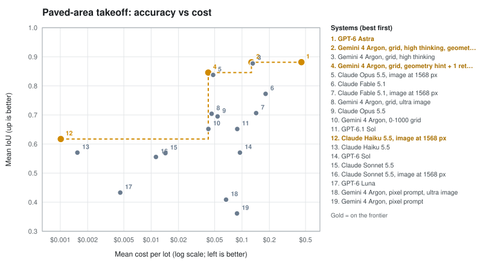
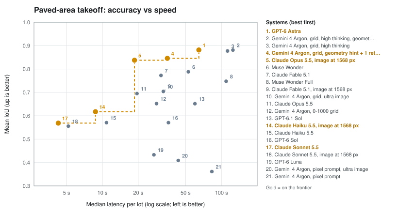
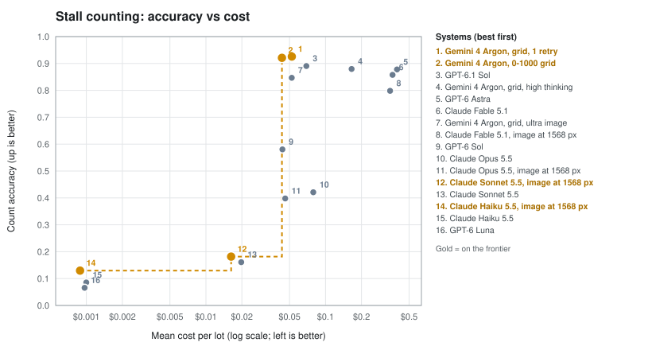
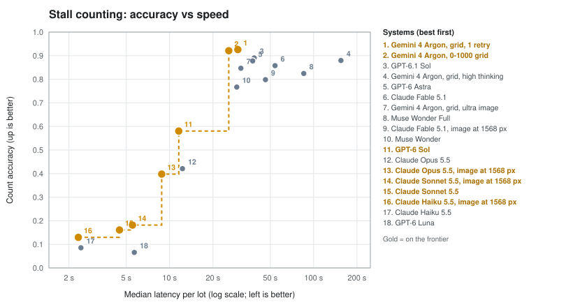
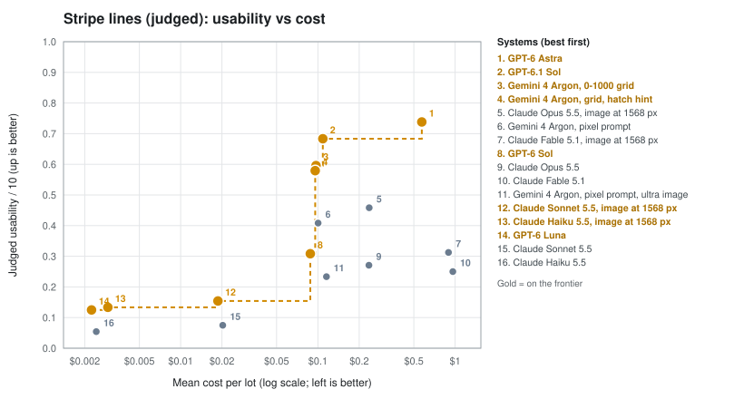

# PaveBench Leaderboard

Latency class: **INSTANT** = p95 wall-clock <= 10 s, **FAST** <= 60 s, **BATCH** > 60 s. The INSTANT badge additionally requires full automation (no human in the loop), pass rate >= 90% over >= 20 reviewed-gold cases spanning >= 2 GSD tiers. See docs/proving-instant-takeoff.md.

*Cases* reads `lots x tries` when each lot was attempted more than once; every attempt is scored. *Valid* is the share of attempts that returned a usable polygon (simple outer ring, holes inside it and apart, every vertex on the image). *App-valid* is the share the submitting application's own validator accepted, when the submission reports it.

## Paved-area takeoff

| System | Track | Automation | Cases | Pass | Valid | App-valid | mean IoU | median areaΔ | p90 areaΔ | cutout recov. | p50 latency | p95 latency | Latency class | mean cost | INSTANT |
|---|---|---|---|---|---|---|---|---|---|---|---|---|---|---|---|
| GPT-6 Astra | vlm_polygon | full_auto | 4 x 3 | 6/12 | 100.0% | 100.0% | 0.882 | 4.9% | 11.7% | 88.8% | 64.6 s | 80.7 s | BATCH | $0.450 | - |
| Gemini 4 Argon, grid, high thinking, geometry hint + 1 retry | vlm_polygon | full_auto | 4 x 3 | 8/12 | 100.0% | 100.0% | 0.881 | 3.6% | 7.3% | 59.5% | 124.9 s | 210.8 s | BATCH | $0.127 | - |
| Gemini 4 Argon, grid, high thinking | vlm_polygon | full_auto | 4 x 3 | 8/12 | 100.0% | 100.0% | 0.877 | 2.9% | 15.3% | 64.6% | 112.4 s | 215.8 s | BATCH | $0.131 | - |
| Gemini 4 Argon, grid, geometry hint + 1 retry | vlm_polygon | full_auto | 4 x 3 | 6/12 | 100.0% | 100.0% | 0.846 | 2.5% | 14.2% | 64.5% | 35.1 s | 50.6 s | FAST | $0.043 | - |
| Claude Opus 5.5, image at 1568 px | vlm_polygon | full_auto | 4 x 3 | 3/12 | 100.0% | 100.0% | 0.838 | 2.1% | 14.9% | 49.0% | 18.6 s | 33.1 s | FAST | $0.048 | - |
| Muse Wonder | vlm_polygon | full_auto | 4 x 3 | 3/12 | 100.0% | 100.0% | 0.788 | 5.4% | 16.4% | 48.0% | 52.7 s | 75.0 s | BATCH | - | - |
| Claude Fable 5.1 | vlm_polygon | full_auto | 4 x 3 | 1/12 | 100.0% | 100.0% | 0.773 | 6.6% | 15.0% | 32.6% | 31.1 s | 44.2 s | FAST | $0.182 | - |
| Muse Wonder Full | vlm_polygon | full_auto | 4 x 3 | 5/12 | 91.7% | 100.0% | 0.748 | 3.0% | 19.4% | 50.5% | 109.5 s | 174.5 s | BATCH | - | - |
| Claude Fable 5.1, image at 1568 px | vlm_polygon | full_auto | 4 x 3 | 0/12 | 91.7% | 91.7% | 0.706 | 3.0% | 12.3% | 43.8% | 33.0 s | 39.6 s | FAST | $0.143 | - |
| Gemini 4 Argon, grid, ultra image | vlm_polygon | full_auto | 4 x 3 | 5/12 | 83.3% | 83.3% | 0.704 | 6.8% | 100.0% | 55.2% | 32.5 s | 67.2 s | BATCH | $0.046 | - |
| Claude Opus 5.5 | vlm_polygon | full_auto | 4 x 3 | 3/12 | 83.3% | 91.7% | 0.695 | 4.9% | 100.0% | 50.6% | 19.5 s | 40.6 s | FAST | $0.054 | - |
| Gemini 4 Argon, 0-1000 grid | vlm_polygon | full_auto | 4 x 3 | 6/12 | 75.0% | 75.0% | 0.652 | 3.4% | 100.0% | 50.2% | 28.5 s | 79.0 s | BATCH | $0.043 | - |
| GPT-6.1 Sol | vlm_polygon | full_auto | 4 x 3 | 5/12 | 75.0% | 75.0% | 0.652 | 6.2% | 100.0% | 64.4% | 59.8 s | 102.3 s | BATCH | $0.089 | - |
| Claude Haiku 5.5, image at 1568 px | vlm_polygon | full_auto | 4 x 3 | 0/12 | 100.0% | 100.0% | 0.617 | 5.0% | 95.5% | 15.7% | 8.7 s | 11.3 s | FAST | $0.001 | - |
| Claude Haiku 5.5 | vlm_polygon | full_auto | 4 x 3 | 0/12 | 100.0% | 100.0% | 0.570 | 11.8% | 94.8% | 2.6% | 10.8 s | 12.2 s | FAST | $0.002 | - |
| GPT-6 Sol | vlm_polygon | full_auto | 4 x 3 | 3/12 | 75.0% | 66.7% | 0.570 | 16.6% | 100.0% | 48.5% | 35.9 s | 51.4 s | FAST | $0.095 | - |
| Claude Sonnet 5.5 | vlm_polygon | full_auto | 4 x 3 | 0/12 | 75.0% | 75.0% | 0.569 | 9.8% | 100.0% | 14.3% | 4.3 s | 5.0 s | INSTANT | $0.014 | - |
| Claude Sonnet 5.5, image at 1568 px | vlm_polygon | full_auto | 4 x 3 | 3/12 | 66.7% | 66.7% | 0.556 | 17.2% | 100.0% | 37.4% | 5.2 s | 7.5 s | INSTANT | $0.011 | - |
| GPT-6 Luna | vlm_polygon | full_auto | 4 x 3 | 1/12 | 58.3% | 66.7% | 0.433 | 22.2% | 100.0% | 2.0% | 27.1 s | 30.7 s | FAST | $0.005 | - |
| Gemini 4 Argon, pixel prompt, ultra image | vlm_polygon | full_auto | 4 x 3 | 1/12 | 50.0% | 50.0% | 0.409 | 56.2% | 100.0% | 31.6% | 43.4 s | 102.9 s | BATCH | $0.067 | - |
| Gemini 4 Argon, pixel prompt | vlm_polygon | full_auto | 4 x 3 | 3/12 | 50.0% | 58.3% | 0.361 | 79.9% | 100.0% | 22.1% | 83.1 s | 138.7 s | BATCH | $0.088 | - |

Notes:

- **GPT-6 Astra**: Reference system for the judged task. Priority tier; reasoning effort medium (low for stall counts).
- **Gemini 4 Argon, grid, high thinking, geometry hint + 1 retry**: The two strongest outline levers together.
- **Gemini 4 Argon, grid, high thinking**: Grid prompt, thinkingLevel high.
- **Gemini 4 Argon, grid, geometry hint + 1 retry**: Grid prompt plus a geometry-rules sentence; re-asked once when the draft failed validation (cost and time of both attempts counted).
- **Claude Opus 5.5, image at 1568 px**: Image downscaled to 1568 px long edge (answer scaled back). Kept to show the cost of lower resolution; Claude often declined to count stalls it called too faint.
- **Muse Wonder**: Through the muse exec CLI (contributor mode off) with --output-schema; image resized to 1568 px. The CLI reports no tokens, so no cost (API list price $4/$20 per MTok).
- **Claude Fable 5.1**: Full image resolution (Claude reads up to 2576 px and answers in real pixels); structured output; effort medium, low for stalls.
- **Muse Wonder Full**: Through the muse exec CLI (contributor mode off) with --output-schema; image resized to 1568 px. Subscription-only model: no per-call cost.
- **Claude Fable 5.1, image at 1568 px**: Image downscaled to 1568 px long edge (answer scaled back). Kept to show the cost of lower resolution; Claude often declined to count stalls it called too faint.
- **Gemini 4 Argon, grid, ultra image**: Grid prompt, per-part ultra_high media resolution.
- **Claude Opus 5.5**: Full image resolution (Claude reads up to 2576 px and answers in real pixels); structured output; effort medium, low for stalls.
- **Gemini 4 Argon, 0-1000 grid**: Prompt built for a 1000x1000 frame; answer scaled to pixels.
- **GPT-6.1 Sol**: Same prompt and settings as GPT-6 Astra. Price $2/$10 per MTok from secondary sources.
- **Claude Haiku 5.5, image at 1568 px**: Image downscaled to 1568 px long edge (answer scaled back). Kept to show the cost of lower resolution; Claude often declined to count stalls it called too faint.
- **Claude Haiku 5.5**: Full image resolution (Claude reads up to 2576 px and answers in real pixels); structured output; effort medium, low for stalls.
- **GPT-6 Sol**: Same prompt and settings as GPT-6 Astra. Price $2/$10 per MTok from secondary sources.
- **Claude Sonnet 5.5**: Full image resolution (Claude reads up to 2576 px and answers in real pixels); structured output; effort medium, low for stalls.
- **Claude Sonnet 5.5, image at 1568 px**: Image downscaled to 1568 px long edge (answer scaled back). Kept to show the cost of lower resolution; Claude often declined to count stalls it called too faint.
- **GPT-6 Luna**: Same prompt and settings as GPT-6 Astra. Price $0.10/$0.50 per MTok from secondary sources.
- **Gemini 4 Argon, pixel prompt, ultra image**: Pixel prompt with per-part ultra_high media resolution; same mixed-axis fault.
- **Gemini 4 Argon, pixel prompt**: Pixel-coordinate prompt; often answers one or both axes on its 0-1000 grid.

## Stall counting

| System | Automation | Cases | Pass (±10%) | mean |countΔ| | median |countΔ| | p90 |countΔ| | App-valid | precision | recall | median loc. err | p50 latency | p95 latency | Latency class | mean cost |
|---|---|---|---|---|---|---|---|---|---|---|---|---|---|---|
| Gemini 4 Argon, pixel prompt | full_auto | 5 x 3 | 13/15 | 4.9% | 3.6% | 12.5% | 80.0% | - | - | - | 25.7 s | 57.7 s | FAST | $0.049 |
| Gemini 4 Argon, grid, 1 retry | full_auto | 5 x 3 | 11/15 | 7.4% | 6.4% | 19.6% | 100.0% | - | - | - | 29.8 s | 63.7 s | BATCH | $0.052 |
| Gemini 4 Argon, 0-1000 grid | full_auto | 5 x 3 | 11/15 | 7.9% | 7.7% | 19.6% | 86.7% | - | - | - | 25.8 s | 49.7 s | FAST | $0.043 |
| GPT-6.1 Sol | full_auto | 5 x 3 | 5/15 | 10.9% | 11.5% | 18.8% | 100.0% | - | - | - | 38.7 s | 47.1 s | FAST | $0.069 |
| Gemini 4 Argon, grid, high thinking | full_auto | 13 | 8/13 | 12.0% | 8.2% | 17.9% | 100.0% | - | - | - | 154.7 s | 189.5 s | BATCH | $0.165 |
| GPT-6 Astra | full_auto | 5 x 3 | 6/15 | 12.2% | 15.1% | 20.5% | 100.0% | - | - | - | 37.7 s | 52.6 s | FAST | $0.396 |
| Claude Fable 5.1 | full_auto | 5 x 3 | 7/15 | 14.2% | 10.3% | 32.9% | 100.0% | - | - | - | 54.0 s | 89.4 s | BATCH | $0.364 |
| Gemini 4 Argon, grid, ultra image | full_auto | 5 x 3 | 7/15 | 15.3% | 11.0% | 45.6% | 86.7% | - | - | - | 31.3 s | 73.6 s | BATCH | $0.052 |
| Muse Wonder Full | full_auto | 14 | 6/14 | 17.6% | 14.4% | 49.6% | 100.0% | - | - | - | 85.4 s | 145.2 s | BATCH | - |
| Claude Fable 5.1, image at 1568 px | full_auto | 5 x 3 | 5/15 | 20.2% | 21.4% | 31.5% | 100.0% | - | - | - | 46.3 s | 101.7 s | BATCH | $0.347 |
| Muse Wonder | full_auto | 14 | 1/14 | 23.3% | 20.5% | 42.7% | 100.0% | - | - | - | 29.2 s | 43.3 s | FAST | - |
| Gemini 4 Argon, pixel prompt, ultra image | full_auto | 5 x 3 | 8/15 | 23.9% | 6.8% | 76.6% | 73.3% | - | - | - | 29.6 s | 84.0 s | BATCH | $0.057 |
| GPT-6 Sol | full_auto | 5 x 3 | 1/15 | 42.0% | 22.3% | 100.0% | 100.0% | - | - | - | 11.6 s | 19.0 s | FAST | $0.044 |
| Claude Opus 5.5 | full_auto | 5 x 3 | 4/15 | 57.9% | 88.4% | 100.0% | 46.7% | - | - | - | 12.3 s | 63.0 s | BATCH | $0.079 |
| Claude Opus 5.5, image at 1568 px | full_auto | 5 x 3 | 2/15 | 60.2% | 84.8% | 100.0% | 66.7% | - | - | - | 8.8 s | 24.1 s | FAST | $0.046 |
| Claude Sonnet 5.5, image at 1568 px | full_auto | 5 x 3 | 0/15 | 81.8% | 90.3% | 100.0% | 46.7% | - | - | - | 5.5 s | 10.3 s | FAST | $0.016 |
| Claude Sonnet 5.5 | full_auto | 5 x 3 | 0/15 | 83.9% | 98.7% | 100.0% | 26.7% | - | - | - | 4.5 s | 12.1 s | FAST | $0.020 |
| Claude Haiku 5.5, image at 1568 px | full_auto | 5 x 3 | 0/15 | 87.0% | 100.0% | 100.0% | 100.0% | - | - | - | 2.3 s | 17.2 s | FAST | $0.001 |
| Claude Haiku 5.5 | full_auto | 5 x 3 | 0/15 | 91.4% | 100.0% | 100.0% | 100.0% | - | - | - | 2.4 s | 12.2 s | FAST | $0.001 |
| GPT-6 Luna | full_auto | 5 x 3 | 0/15 | 93.4% | 100.0% | 100.0% | 100.0% | - | - | - | 5.7 s | 8.6 s | INSTANT | $0.001 |

Notes:

- **Gemini 4 Argon, pixel prompt**: Pixel-coordinate prompt; often answers one or both axes on its 0-1000 grid. Not on the frontier: its stall centers are often in the wrong place (mixed coordinate frames, checked on overlays); this set has no per-stall gold markers, so count-only scoring cannot see it.
- **Gemini 4 Argon, grid, 1 retry**: Grid prompt; re-asked once when the draft failed validation (cost and time of both attempts counted).
- **Gemini 4 Argon, 0-1000 grid**: Prompt built for a 1000x1000 frame; answer scaled to pixels.
- **GPT-6.1 Sol**: Same prompt and settings as GPT-6 Astra. Price $2/$10 per MTok from secondary sources.
- **Gemini 4 Argon, grid, high thinking**: Grid prompt, thinkingLevel high.
- **GPT-6 Astra**: Reference system for the judged task. Priority tier; reasoning effort medium (low for stall counts).
- **Claude Fable 5.1**: Full image resolution (Claude reads up to 2576 px and answers in real pixels); structured output; effort medium, low for stalls.
- **Gemini 4 Argon, grid, ultra image**: Grid prompt, per-part ultra_high media resolution.
- **Muse Wonder Full**: Through the muse exec CLI (contributor mode off) with --output-schema; image resized to 1568 px. Subscription-only model: no per-call cost.
- **Claude Fable 5.1, image at 1568 px**: Image downscaled to 1568 px long edge (answer scaled back). Kept to show the cost of lower resolution; Claude often declined to count stalls it called too faint.
- **Muse Wonder**: Through the muse exec CLI (contributor mode off) with --output-schema; image resized to 1568 px. The CLI reports no tokens, so no cost (API list price $4/$20 per MTok).
- **Gemini 4 Argon, pixel prompt, ultra image**: Pixel prompt with per-part ultra_high media resolution; same mixed-axis fault. Not on the frontier: its stall centers are often in the wrong place (mixed coordinate frames, checked on overlays); this set has no per-stall gold markers, so count-only scoring cannot see it.
- **GPT-6 Sol**: Same prompt and settings as GPT-6 Astra. Price $2/$10 per MTok from secondary sources.
- **Claude Opus 5.5**: Full image resolution (Claude reads up to 2576 px and answers in real pixels); structured output; effort medium, low for stalls.
- **Claude Opus 5.5, image at 1568 px**: Image downscaled to 1568 px long edge (answer scaled back). Kept to show the cost of lower resolution; Claude often declined to count stalls it called too faint.
- **Claude Sonnet 5.5, image at 1568 px**: Image downscaled to 1568 px long edge (answer scaled back). Kept to show the cost of lower resolution; Claude often declined to count stalls it called too faint.
- **Claude Sonnet 5.5**: Full image resolution (Claude reads up to 2576 px and answers in real pixels); structured output; effort medium, low for stalls.
- **Claude Haiku 5.5, image at 1568 px**: Image downscaled to 1568 px long edge (answer scaled back). Kept to show the cost of lower resolution; Claude often declined to count stalls it called too faint.
- **Claude Haiku 5.5**: Full image resolution (Claude reads up to 2576 px and answers in real pixels); structured output; effort medium, low for stalls.
- **GPT-6 Luna**: Same prompt and settings as GPT-6 Astra. Price $0.10/$0.50 per MTok from secondary sources.

## Frontiers

A system is on a frontier when no other system is at least as accurate and cheaper (or faster). Accuracy is mean IoU for paved-area takeoff (invalid polygons score 0) and 1 - mean absolute count error for stall counting.

Frontier: Claude Haiku 5.5, image at 1568 px → Gemini 4 Argon, grid, geometry hint + 1 retry → Gemini 4 Argon, grid, high thinking, geometry hint + 1 retry → GPT-6 Astra

Frontier: Claude Sonnet 5.5 → Claude Haiku 5.5, image at 1568 px → Claude Opus 5.5, image at 1568 px → Gemini 4 Argon, grid, geometry hint + 1 retry → GPT-6 Astra

Frontier: Claude Haiku 5.5, image at 1568 px → Claude Sonnet 5.5, image at 1568 px → Gemini 4 Argon, 0-1000 grid → Gemini 4 Argon, grid, 1 retry

Frontier: Claude Haiku 5.5, image at 1568 px → Claude Sonnet 5.5 → Claude Sonnet 5.5, image at 1568 px → Claude Opus 5.5, image at 1568 px → GPT-6 Sol → Gemini 4 Argon, 0-1000 grid → Gemini 4 Argon, grid, 1 retry

## Stripe lines (judged by claude-opus-5-5, no gold)

No hand-traced stripe gold exists. Claude Opus 5.5 (effort high) saw the aerial photo and two blinded striping overlays of the same lot (cyan seen paint, magenta inferred paint), scored each for usability in a restripe quote and tallied its faults, and picked the one a contractor should trust. Every challenger try was paired with the GPT-6 Astra try of the same lot and number, in both A/B orders. 396 judgments, $21.71 of judge cost; 0 refused. Cost and latency columns are the striping system's own, not the judge's.

Calibration: the reference against its own second try won 67% (a fair judge is near 50%); the judge gave the same verdict in both A/B orders on 95% of 198 pairs.

| System | Lots | Comparisons | Win rate vs GPT-6 Astra | mean usability (0-10) | rows missed / draft | many lines without paint | hatching outline-only or missing | p50 latency | mean cost |
|---|---|---|---|---|---|---|---|---|---|
| GPT-6 Astra | 6 | 384 | - | 7.4 | 0.1 | 1% | 0% | 242.7 s | $0.572 |
| GPT-6.1 Sol | 6 | 24 | 35% | 6.8 | 0.5 | 0% | 0% | 185.4 s | $0.109 |
| Gemini 4 Argon, 0-1000 grid | 6 | 24 | 23% | 6.0 | 0.4 | 17% | 25% | 65.6 s | $0.097 |
| Gemini 4 Argon, grid, hatch hint | 6 | 24 | 31% | 5.8 | 0.2 | 12% | 10% | 78.5 s | $0.096 |
| Claude Opus 5.5, image at 1568 px | 6 | 24 | 0% | 4.6 | 2.0 | 12% | 60% | 84.8 s | $0.236 |
| Gemini 4 Argon, pixel prompt | 6 | 24 | 4% | 4.1 | 1.0 | 38% | 20% | 69.1 s | $0.100 |
| Claude Fable 5.1, image at 1568 px | 6 | 24 | 0% | 3.1 | 1.4 | 54% | 10% | 173.1 s | $0.894 |
| GPT-6 Sol | 5 | 24 | 0% | 3.1 | 3.4 | 0% | 33% | 48.7 s | $0.088 |
| Claude Opus 5.5 | 6 | 24 | 0% | 2.7 | 3.4 | 29% | 70% | 81.5 s | $0.236 |
| Claude Fable 5.1 | 6 | 24 | 0% | 2.5 | 2.2 | 50% | 15% | 170.5 s | $0.963 |
| Gemini 4 Argon, pixel prompt, ultra image | 6 | 24 | 0% | 2.3 | 3.5 | 83% | 70% | 58.3 s | $0.116 |
| Muse Wonder | 5 | 24 | 0% | 2.2 | 1.9 | 70% | 50% | 33.2 s | - |
| Muse Wonder Full | 6 | 24 | 0% | 1.9 | 0.8 | 75% | 7% | 86.7 s | - |
| Claude Sonnet 5.5, image at 1568 px | 6 | 24 | 0% | 1.5 | 6.3 | 0% | 100% | 5.1 s | $0.019 |
| Claude Haiku 5.5, image at 1568 px | 6 | 24 | 0% | 1.3 | 6.9 | 54% | 80% | 18.7 s | $0.003 |
| GPT-6 Luna | 6 | 24 | 0% | 1.2 | 5.2 | 70% | 89% | 32.3 s | $0.002 |
| Claude Sonnet 5.5 | 6 | 24 | 0% | 0.8 | 7.2 | 0% | 100% | 7.8 s | $0.020 |
| Claude Haiku 5.5 | 6 | 24 | 0% | 0.5 | 7.6 | 75% | 100% | 14.4 s | $0.002 |

Notes:

- **Claude Opus 5.5, image at 1568 px**: Same vendor as the judge (Claude Opus 5.5). Gemini 4 Argon re-judged its 24 pairs and agreed on 100%.
- **Claude Fable 5.1, image at 1568 px**: Same vendor as the judge (Claude Opus 5.5). Gemini 4 Argon re-judged its 24 pairs and agreed on 96%.
- **GPT-6 Sol**: 3 tries returned no stripes (scored as losses, usability 0).
- **Claude Opus 5.5**: Same vendor as the judge (Claude Opus 5.5). Gemini 4 Argon re-judged its 24 pairs and agreed on 100%.
- **Claude Fable 5.1**: Same vendor as the judge (Claude Opus 5.5). Gemini 4 Argon re-judged its 24 pairs and agreed on 100%.
- **Muse Wonder**: 2 tries returned no stripes (scored as losses, usability 0).
- **Muse Wonder Full**: 4 tries returned no stripes (scored as losses, usability 0).
- **Claude Sonnet 5.5, image at 1568 px**: Same vendor as the judge (Claude Opus 5.5). Gemini 4 Argon re-judged its 24 pairs and agreed on 100%.
- **Claude Haiku 5.5, image at 1568 px**: Same vendor as the judge (Claude Opus 5.5). Gemini 4 Argon re-judged its 24 pairs and agreed on 100%.
- **GPT-6 Luna**: 2 tries returned no stripes (scored as losses, usability 0).
- **Claude Sonnet 5.5**: Same vendor as the judge (Claude Opus 5.5). Gemini 4 Argon re-judged its 22 pairs and agreed on 100%. 1 try returned no stripes (scored as losses, usability 0).
- **Claude Haiku 5.5**: Same vendor as the judge (Claude Opus 5.5). Gemini 4 Argon re-judged its 24 pairs and agreed on 100%.

Frontier: GPT-6 Luna → Claude Haiku 5.5, image at 1568 px → Claude Sonnet 5.5, image at 1568 px → GPT-6 Sol → Gemini 4 Argon, grid, hatch hint → Gemini 4 Argon, 0-1000 grid → GPT-6.1 Sol → GPT-6 Astra
